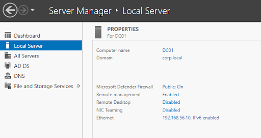
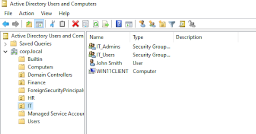
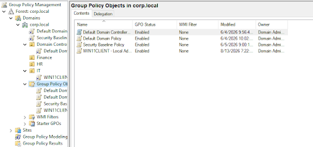
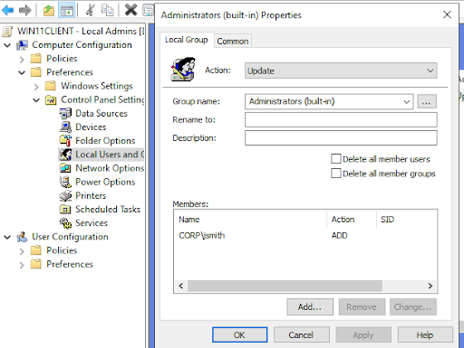
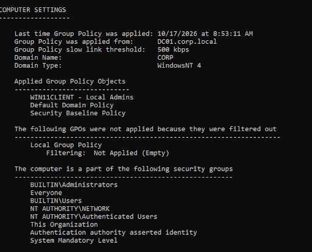
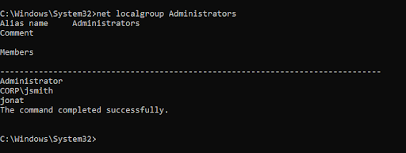
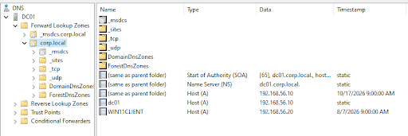

# Active Directory Administration and Windows Security Lab

## Overview

This project demonstrates hands-on Windows infrastructure and Active Directory administration in a virtual lab built with Oracle VirtualBox, Windows Server 2022, and Windows 11 Pro.

The lab focuses on configuring a domain controller, managing Active Directory objects, organizing departmental resources, configuring Group Policy, and verifying policy application on a domain-joined Windows client.

## Lab Environment

| Component | Configuration |
|---|---|
| Virtualization | Oracle VirtualBox |
| Server | Windows Server 2022 |
| Domain Controller | DC01 |
| Active Directory Domain | corp.local |
| Domain Controller IP | 192.168.56.10 |
| Windows Client | Windows 11 Pro |
| Client Hostname | WIN11CLIENT |
| Client IP | 192.168.56.20 |
| DNS | Active Directory-integrated domain DNS |

## Skills Demonstrated

- Active Directory Domain Services (AD DS)
- Windows Server administration
- DNS configuration and host records
- Organizational units, user accounts, and security groups
- Group Policy Objects (GPOs)
- Domain joining and client administration
- Local administrator group management
- Group Policy verification and troubleshooting
- Virtual machine networking

## Implementation and Verification

### 1. Domain Controller Configuration

Configured a Windows Server 2022 virtual machine as the domain controller for the `corp.local` domain. The server provides the Active Directory and DNS infrastructure used by the lab.

### 2. Active Directory Structure

Organized directory objects into departmental organizational units, including Finance, HR, and IT. The IT OU contains the lab's IT security groups, a test user account, and the Windows client computer account.

This structure demonstrates the organization of directory objects for administrative management and potential policy assignment.

### 3. Group Policy Objects

Reviewed the domain's Group Policy Objects, including the custom `WIN11CLIENT - Local Admins` policy and other policies present in the environment.

### 4. Local Administrator Policy Configuration

Configured the `WIN11CLIENT - Local Admins` GPO to manage local Administrators group membership on the Windows client.

This demonstrates the use of Group Policy to centrally manage a client-side security setting.

### 5. Group Policy Application Verification

Used `gpresult /r` on the Windows client to inspect computer-level Group Policy processing. The results showed that `WIN11CLIENT - Local Admins` was listed among the applied Group Policy Objects, with `DC01.corp.local` identified as the policy source.

### 6. Local Administrator Membership Verification

Used the `net localgroup Administrators` command on the Windows client to inspect local administrator membership. The output confirmed that `CORP\jsmith` was present in the local Administrators group.

This provided a separate verification of the resulting group membership in addition to the Group Policy processing results.

### 7. DNS Configuration

Inspected the `corp.local` forward lookup zone in DNS Manager. The zone contained host (A) records for the domain controller (`dc01`) and Windows client (`WIN11CLIENT`), mapping them to their respective lab IP addresses.

## Key Takeaways

This project provided practical experience with Windows domain infrastructure, directory administration, DNS records, Group Policy configuration, and client-side verification.

It also reinforced the importance of validating configuration changes instead of relying solely on administrative console settings.

## Future Improvements

Potential extensions to the lab include:

- Automating user and group administration with PowerShell.
- Documenting additional password and account-lockout policies.
- Exploring least-privilege access and delegated administration.

## Related Projects

See my separate security monitoring lab for work involving Windows event collection, Sysmon, and Splunk.
[https://github.com/jonathanvarughese1/active-directory-security-monitoring](url)

## Disclaimer

This project was conducted in a controlled virtual lab using test accounts and systems for educational and portfolio purposes.
